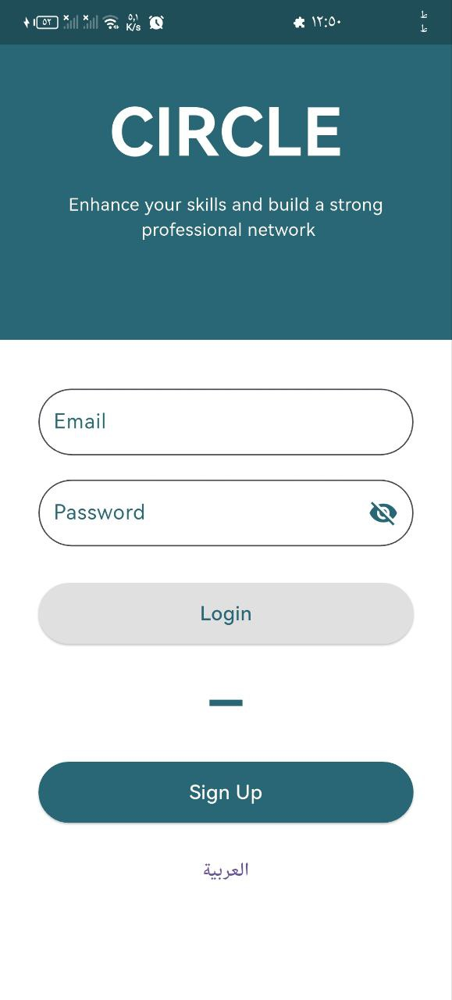
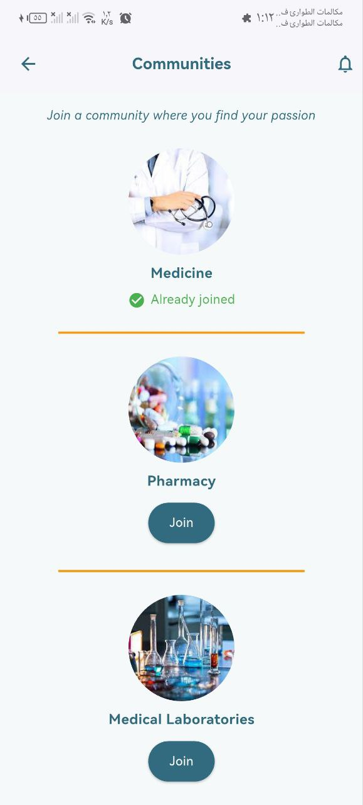
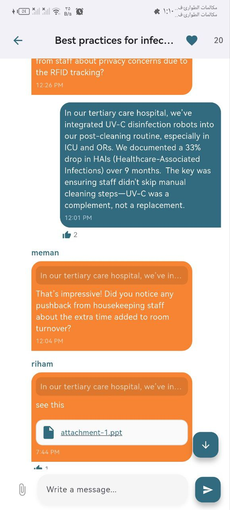
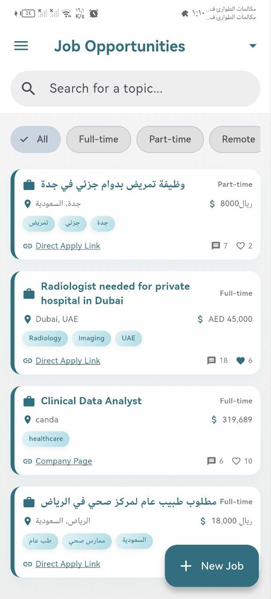
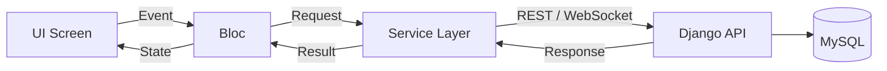

# CIRCLE — Educational & Professional Community Platform

CIRCLE is a community platform that connects learners, professionals and organizations in specialized communities, organized by field and experience level. Members can join real-time discussion rooms, share learning resources, and find jobs and internships posted by organizations.

🎬 **Demo video:** [Watch the app in action](https://drive.google.com/file/d/1FqwB_L4NzgyURPeBGTDyLFXboYywapkw/view?usp=sharing)

> 🎓 Graduation Project — B.Sc. Software Engineering, Sudan University of Science and Technology (2025)

---

## 📱 Screenshots

| Login | Communities | Discussion Room | Jobs |
|:---:|:---:|:---:|:---:|
|  |  |  |  |

---

## ✨ Features

- **Authentication & Accounts:** registration, login and profile management secured with JWT
- **Role-Based Access:** separate experiences for Users, Organizations and Admins
- **Specialized Communities:** grouped by field and experience level
- **Real-time Discussion Rooms:** live messaging and updates over WebSockets
- **Resource Sharing:** upload and share files and learning materials
- **Jobs & Internships:** organizations post opportunities for community members
- **Search & Rating:** search content and rate posts
- **Multilingual:** full Arabic and English support, including right-to-left (RTL) layout
- **Responsive UI:** adapts to different screen sizes
- **Admin Dashboard:** manage communities, users and organizations

---

## 🛠 Tech Stack

| Layer | Technologies |
|---|---|
| Mobile App | Flutter, Dart |
| State Management | BLoC (`flutter_bloc`) |
| Networking | `http` (REST API), `web_socket_channel` (WebSockets) |
| Local Storage | `shared_preferences` |
| UI & Localization | `flutter_screenutil`, `flutter_localizations`, `intl` |
| Backend | Django 5.1, Django REST Framework, SimpleJWT |
| Real-time | Django Channels, Redis |
| Database | MySQL |
| Design | Adobe XD |
| Analysis & Design | UML (Use Case, Class, Sequence, Activity), ERD |
| Tools & Methodology | Git & GitHub, Agile (Sprints) |

---

## 🏗 Architecture

The Flutter app follows a **feature-based BLoC architecture**, separating UI from business logic. Each feature (Authentication, Communities, Threads) has its own Bloc, and all backend communication is handled by a service layer.



**Example: Login flow**
1. The login screen dispatches a `LoginEvent` to `AuthBloc`.
2. `AuthBloc` calls `AuthService`, which sends the request to the backend.
3. `AuthBloc` emits a new `AuthState` (loading / success / failure).
4. `BlocBuilder` rebuilds the UI from the state, while `BlocListener` handles side effects such as navigation and error messages.
5. `setState` is used only for simple local UI state within a screen.

**Real-time chat:** the app opens a WebSocket connection to Django Channels, which uses Redis as a channel layer to deliver messages instantly to all members of a discussion room.

---

## ⚙️ Running Locally

Requires **MySQL**, **Redis** (Memurai on Windows), **Python** and **Flutter**.

The backend runs as an ASGI server to support both HTTP and WebSockets:

```bash
python -m daphne -b 0.0.0.0 -p 8000 CIRCLE.asgi:application
```

Then run the Flutter app:

```bash
flutter pub get
flutter run
```

> Set your computer's local IP address in the app's API configuration file, and make sure the phone and the computer are on the same network. When using the Android emulator, use `10.0.2.2:8000` instead.

---

## 🧪 Testing

The system was verified through **functional**, **integration** and **acceptance testing** during development sprints.

---

## 👥 Team

| Member | Role |
|---|---|
| **Riham Abd-Elfatah** | Full Flutter app development & API integration, backend contribution |
| **Abeer Abdo Adam** | Backend development |
| 
