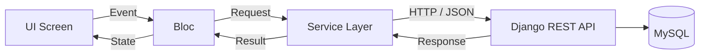

# CIRCLE — Educational & Professional Community Platform

CIRCLE is a community platform that connects learners, professionals and organizations in specialized communities, organized by field and experience level. Members can join discussion rooms, share learning resources, and find jobs and internships posted by organizations.

> 🎓 Graduation Project — B.Sc. Software Engineering, Sudan University of Science and Technology (2025)

<!-- Add a demo video link here if available: -->
<!-- 🎬 **Demo video:** [Watch on YouTube / Google Drive](LINK) -->

---

## 📱 Screenshots

| Login | Communities | Discussion Room | Jobs |
|:---:|:---:|:---:|:---:|
|  |  |  |  |

---

## ✨ Features

- **Authentication & Accounts:** registration, login and profile management
- **Role-Based Access:** separate experiences for Users, Organizations and Admins
- **Specialized Communities:** grouped by field and experience level
- **Discussion Rooms:** interactive threads with real-time updates
- **Resource Sharing:** upload and share files and learning materials
- **Jobs & Internships:** organizations post opportunities for community members
- **Search & Rating:** search content and rate posts
- **Admin Dashboard:** manage communities, users and organizations

---

## 🛠 Tech Stack

| Layer | Technologies |
|---|---|
| Mobile App | Flutter, Dart |
| State Management | BLoC (`flutter_bloc`) |
| Backend | Django (Python), REST API |
| Database | MySQL |
| Design | Adobe XD |
| Analysis & Design | UML (Use Case, Class, Sequence, Activity), ERD |
| Version Control | Git & GitHub |
| Methodology | Agile (Sprints) |

---

## 🏗 Architecture

The Flutter app follows a **feature-based BLoC architecture**, separating UI from business logic. Each feature (Authentication, Communities, Threads) has its own Bloc, and backend calls are handled by a service layer.



**Example: Login flow**
1. The login screen dispatches a `LoginEvent` to `AuthBloc`.
2. `AuthBloc` calls `AuthService`, which sends the request to the backend.
3. `AuthBloc` emits a new `AuthState` (loading / success / failure).
4. `BlocBuilder` rebuilds the UI from the state, while `BlocListener` handles side effects such as navigation and error messages.
5. `setState` is used only for simple local UI state within a screen.

---

## 📂 Project Structure

<!-- Replace with the real folder names in the repo -->
```
CIRCLE/
├── mobile/        # Flutter application
│   └── lib/
│       ├── blocs/       # AuthBloc, CommunityBloc, ThreadBloc...
│       ├── services/    # AuthService and API services
│       ├── models/      # Data models (JSON serialization)
│       ├── screens/     # UI screens
│       └── widgets/     # Reusable widgets
└── backend/       # Django REST API
```

---

## 🚀 Getting Started

### Prerequisites
- Flutter SDK
- Python 3
- MySQL Server

### 1. Backend (Django)
```bash
cd backend
python -m venv venv
source venv/bin/activate        # On Windows: venv\Scripts\activate
pip install -r requirements.txt
```
Create a MySQL database and update the database settings in `settings.py`, then run:
```bash
python manage.py migrate
python manage.py createsuperuser
python manage.py runserver
```

### 2. Mobile App (Flutter)
```bash
cd mobile
flutter pub get
flutter run
```
> **Note:** When running on the Android emulator, use `http://10.0.2.2:8000` as the API base URL to reach the local Django server.

<!-- Mention the file where the base URL is set, e.g. lib/services/api_config.dart -->

---

## 🧪 Testing

The system was verified through **functional**, **integration** and **acceptance testing** during development sprints.

---

## 👥 Team

| Member | Role |
|---|---|
| **Riham Abd-Elfatah** | Flutter app development, backend contribution |
| **Abeer Abdo Adam** | backend development |
| **Eilaf Adil Yousif** | backend development |
